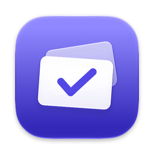
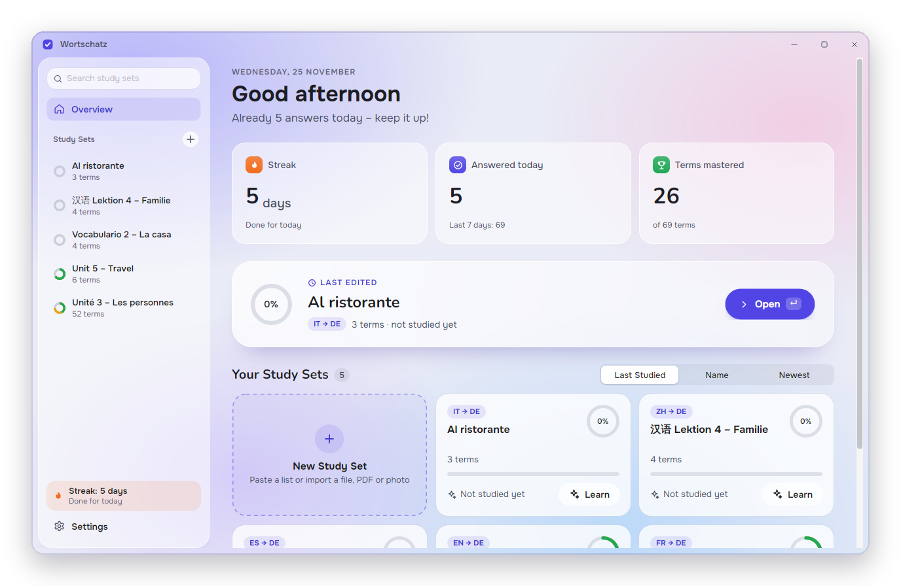
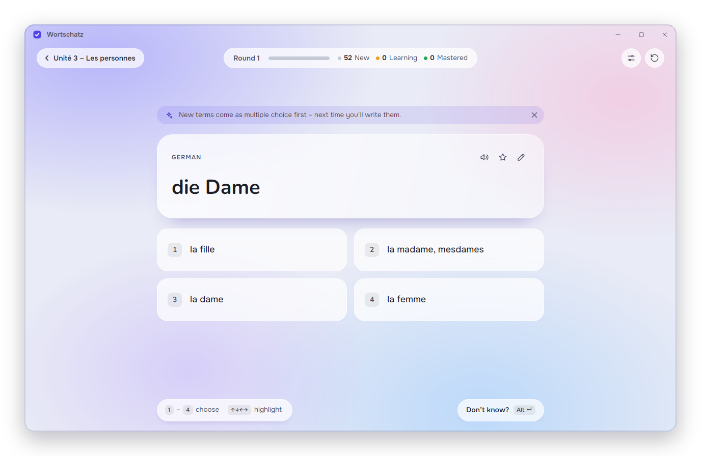
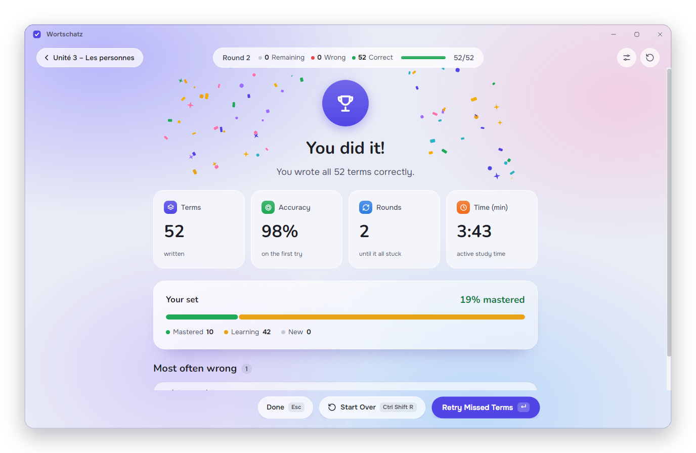
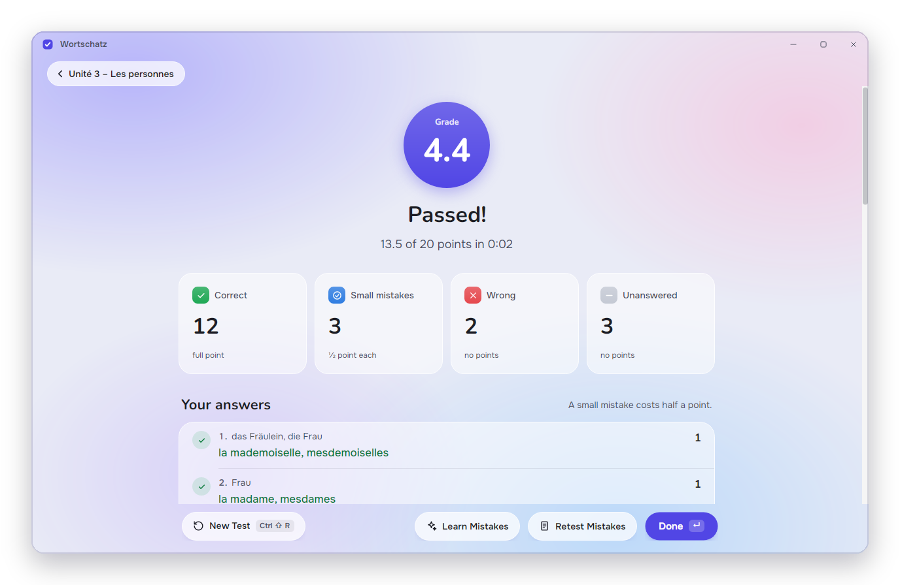
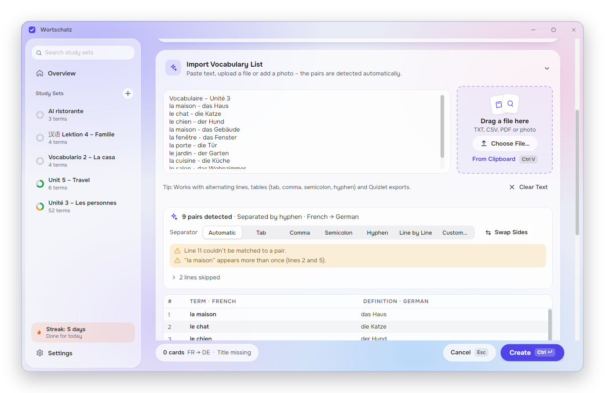
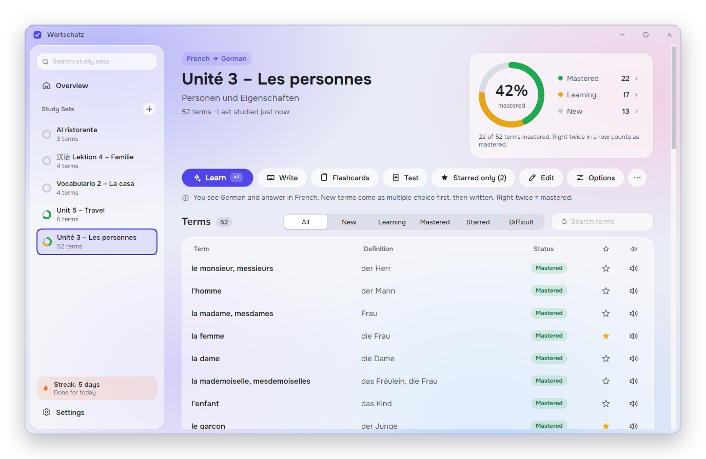

<div align="center">



# Wortschatz

**Learn vocabulary until it sticks.**

A vocabulary trainer for Mac and Windows. New words come up as multiple choice first, then you type them yourself.<br>
Free, no ads, no account, and your study sets stay on your computer.

[](#download)
[](#download)
[](#support)
[](https://ko-fi.com/anthonybuilds13)
[](https://www.linkedin.com/in/anthonydangelo13)

**[Download](https://wortschatz.duckdns.org/en)** · **[What’s new](Downloadseite/public/_neuigkeiten.md)** · **[Support ☕](https://ko-fi.com/anthonybuilds13)**

<br>

<picture>
  <source media="(prefers-color-scheme: dark)" srcset=".github/readme/overview-dark.png">
  
</picture>

</div>

## Features

- 🧠 **Learn**: new terms come as multiple choice, then you write them. Right twice in a row counts as mastered.
- ✍️ **Write**: type every term, round after round, until each one has stuck.
- 🃏 **Flashcards**: flip, then swipe to *Know it* or *Still learning*.
- 📝 **Test**: all questions on one page, with a time limit and a Swiss school grade at the end.
- 📥 **Import almost anything**: paste a list or drop a TXT, CSV, PDF or photo, and terms and translations are
  detected automatically (Quizlet exports too).
- ✅ **Fair answer checking**: synonyms count, a small mistake costs half a point, and accents are one click away.
- 🔥 **Motivation built in**: streaks, progress rings, sounds and confetti, plus read-aloud for every term.
- ⌨️ **Keyboard first**: everything runs on the Return key. Light and dark mode included.
- 🌍 **Many languages**: learn French, English, Spanish, Italian, Arabic, Mandarin and more. The app itself is in
  German and English.

## Screenshots

<table>
  <tr>
    <td width="50%" align="center"><br><sub><b>Learn</b>: multiple choice first, then written</sub></td>
    <td width="50%" align="center"><br><sub><b>Flashcards</b>: swipe right if you know it</sub></td>
  </tr>
  <tr>
    <td width="50%" align="center"><br><sub><b>Write</b>: round after round until every term sticks</sub></td>
    <td width="50%" align="center"><br><sub><b>Test</b>: a grade like at school</sub></td>
  </tr>
  <tr>
    <td width="50%" align="center"><br><sub><b>Import</b>: paste a list, the pairs are detected</sub></td>
    <td width="50%" align="center"><br><sub><b>Study set</b>: see what you’ve mastered at a glance</sub></td>
  </tr>
</table>

<p align="center"><sub>The screenshots show the Windows app. The Mac app shares its design.</sub></p>

## Download

Get the latest version at **[wortschatz.duckdns.org](https://wortschatz.duckdns.org/en)**:

- 🍏 **Mac**: macOS 26 or later, Apple Silicon
- 🪟 **Windows**: Windows 10 or 11, a single file with nothing to install

## Support

Wortschatz is free, with no ads and no account, and it’s meant to stay that way. If the app helps you learn, you can
**[buy me a coffee on Ko-fi](https://ko-fi.com/anthonybuilds13)**. Every donation gives me more time for new
features and improvements.

[](https://ko-fi.com/anthonybuilds13)

## For developers

<details>
<summary><b>What’s in this repository, and how to build it</b></summary>

<br>

| Folder | What it is |
|---|---|
| `mac/` | The Mac app (SwiftUI, macOS 26, Apple Silicon). The logic lives in the Swift package `mac/Packages/WortschatzCore`, the interface in `mac/Wortschatz/`. |
| `windows-native/` | The Windows app (C#, .NET 10, Avalonia): one exe with nothing to install, ported function by function from the Mac app ([PORTING.md](windows-native/PORTING.md)). |
| `Downloadseite/` | The download site (Node, no packages) with the changelog `Downloadseite/public/_neuigkeiten.md`. |
| `Website/` | The original web version. No longer shipped, but the test cases that both apps are checked against come from it (`mac/Parity/`). |

Mac (Xcode 26):

```bash
mac/scripts/test.sh            # core tests, build the app, app tests
mac/scripts/build.sh           # release build: mac/build/Wortschatz.app
mac/scripts/gen-fixtures.sh    # regenerate the test cases from Website/ (must not change anything)
```

Windows (.NET 10 SDK, also runs on macOS and Linux):

```bash
windows-native/build.sh test   # core tests, then windows-native/dist/Wortschatz.exe
```

Download site (Node 20 or later) and the web reference:

```bash
cd Downloadseite && node server/server.mjs                    # http://localhost:8080
cd Downloadseite/server && node --test test/*.test.mjs
Website/tests/run.sh
```

New versions reach the download site as GitHub releases: [VEROEFFENTLICHEN.md](VEROEFFENTLICHEN.md) (in German).

</details>

## License

None. The code is here to look at, and all rights remain with the authors.
